# KiTalk · Flutter 播客客户端

按 **Pixso《KiTalk》设计文件** 1:1 还原的 Flutter 播客应用，覆盖暗色 / 亮色两套主题下的全部 17 个界面。
无后端，所有内容由 `lib/data/catalog.dart` 的静态数据驱动，可直接运行，也可替换成真实仓库。

| Home（暗色） | Player | Search | Profile | Home（亮色） |
| --- | --- | --- | --- | --- |
| 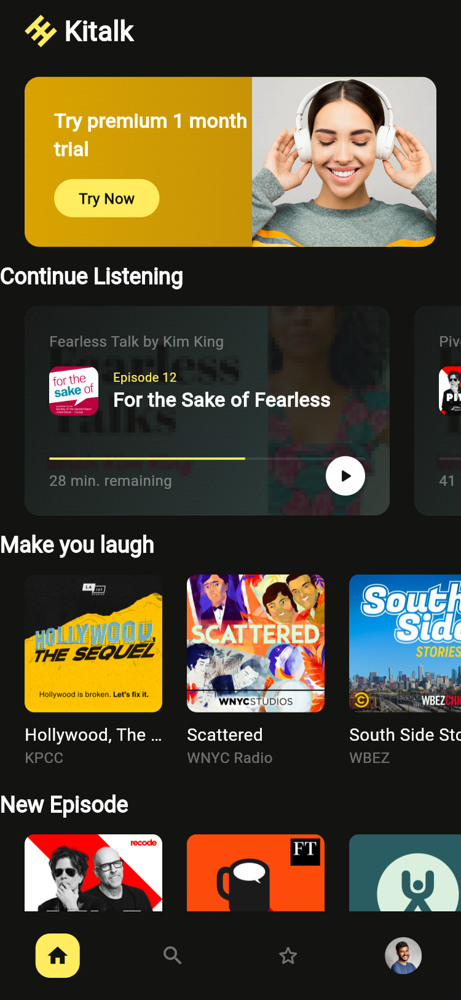 | 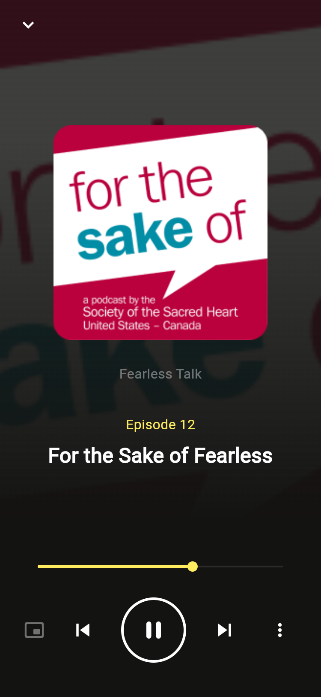 |  | 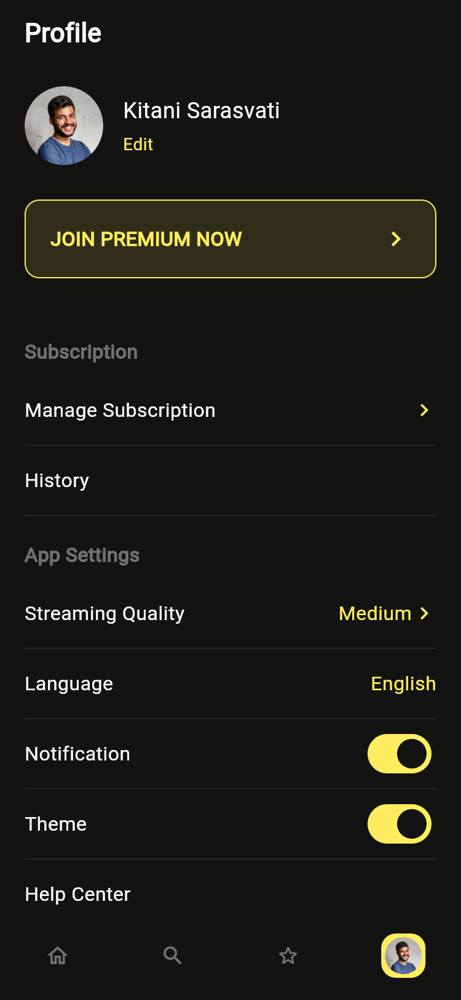 | 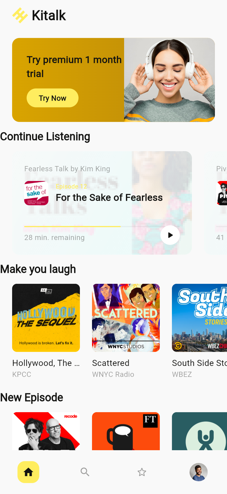 |

- 技术栈：Flutter 3.47.7 / Dart 3.13.5、Material 3、`provider`
- 代码量：21 个 Dart 文件、约 3100 行；36 张从 Pixso 导出的位图资源
- 校验：`flutter analyze` 0 issue、`flutter test` 通过、Android 模拟器 release 包实机运行

## 快速开始

```bash
flutter pub get
flutter run        # Android / iOS
flutter test       # 冒烟测试
flutter analyze    # 0 issue
```

## 目录结构

```
KitalkPodcast/                  ← 仓库根即 Flutter 工程
├── assets/
│   ├── img/                # 36 张位图：封面、分类图、头像、Logo、背景
│   └── fonts/              # Poppins Regular / Medium / SemiBold / Bold
├── lib/
│   ├── main.dart           # 根组件：注入 KtStore + 明暗主题，入口 OnboardingPage
│   ├── core/               # ── 与业务无关的地基
│   │   ├── theme.dart      #   KtPalette(ThemeExtension) + KtTheme.build()
│   │   ├── widgets.dart    #   14 个共享组件（封面/按钮/输入框/卡片/列表行…）
│   │   └── sheets.dart     #   底部弹窗脚手架 + 音质选择 / 单集操作弹窗
│   ├── data/               # ── 数据层
│   │   ├── models.dart     #   Show / Episode / BrowseCategory
│   │   └── catalog.dart    #   KtData：全部设计稿文案与图片的静态仓库
│   ├── state/              # ── 状态层
│   │   └── app_store.dart  #   KtStore(ChangeNotifier)：主题 / 播放 / 收藏 / 个人资料
│   ├── shell/              # ── 导航外壳
│   │   └── kt_shell.dart   #   四 Tab + 常驻迷你播放条 + 播放/暂停按钮
│   └── features/           # ── 界面层，一屏一目录
│       ├── onboarding/  auth/  home/  show/  player/
│       ├── search/      category/  favourites/
│       └── profile/     subscription/
├── test/widget_test.dart   # 冒烟测试：启动后能看到 Sign up / Log in
├── android/  ios/          # 平台工程
├── docs/screenshots/       # 应用实机 / 实渲截图（20 张）
└── design_ref/             # 从 Pixso 导出的设计稿原图（还原基准，不参与编译）
    ├── dark/  (17 张)
    └── light/ (2 张)
```

## 架构分层

```
main.dart
  └─ ChangeNotifierProvider<KtStore>          ← 全局唯一状态
       └─ MaterialApp(theme / darkTheme / themeMode)
            ├─ OnboardingPage ──> LoginPage / SignupPage   （认证流）
            │                        └─ pushReplacement ──> KtShell
            └─ KtShell                                      （主壳）
                 ├─ HomePage      ├─ SearchPage    ├─ FavouritesPage   ├─ ProfilePage
                 ├─ KtMiniPlayer  └─ KtBottomNav
                 └─ 子路由：ShowPage · PlayerPage · CategoryPage · SearchResultPage
                            EditProfilePage · SubscriptionPage
```

依赖方向单向向下，界面层不互相依赖数据实现：

| 层 | 职责 | 允许依赖 |
| --- | --- | --- |
| `core/` | 设计令牌、通用组件、弹窗脚手架 | 仅 Flutter + `data/models.dart` |
| `data/` | 实体定义与内容仓库 | 无（纯数据） |
| `state/` | 会话期可变状态 | `data/` |
| `shell/` | Tab 容器与迷你播放条 | `core/`、`state/`、`features/` |
| `features/` | 单个界面的还原与交互装配 | 其余全部 |

把 `KtData` 换成真实 Repository 时，只需保证 `Show / Episode / BrowseCategory` 三个实体不变，`features/` 层无需改动。

## 设计稿解析

设计文件包含 4 个页面分类，开发前用 Pixso MCP 逐页拉取节点树与样式表，再导出位图资源：

| Pixso 页面 | 内容 | 用途 |
| --- | --- | --- |
| StyleGuide | 色板（Black / White / Yellow）、Poppins 字阶 | 生成 `KtPalette` 与 `TextTheme` |
| Dark Theme | 17 个主画板 | 全部功能界面的还原基准 |
| Light Theme | 同结构亮色画板 | 校验 `KtPalette.light` |
| Symbols | 组件与位图节点 | 导出 `assets/img/` 下 36 张图 |

两个 "Dark - Home" 画板实际是同一屏的顶部与滚动后状态；"Player Minimize" 是带常驻迷你播放条的 Home。
因此代码里 Home 只有一个实现，迷你播放条由 `KtStore.showMiniPlayer` 控制。

## 设计令牌

令牌集中在 [lib/core/theme.dart](lib/core/theme.dart)，以 `ThemeExtension` 注册，界面通过 `pal(context).accent` 取色，避免在组件里判断 brightness：

| Token | Dark | Light | 用途 |
| --- | --- | --- | --- |
| `background` | `#131311` | `#F9F9F9` | 页面底色 |
| `surface` | `#1D1D1B` | `#FFFFFF` | 卡片 / 输入框底 |
| `onBackground` | `#FFFFFF` | `#131311` | 主文本 |
| `muted` | 白 40% | 黑 40% | 次要文本、描边 |
| `faint` | 白 10% | 黑 5% | 进度条底、分隔 |
| `accent` | `#FFED5F` | `#FFED5F` | 品牌黄：按钮、选中态、Episode 标签 |
| `onAccent` | `#131311` | `#131311` | 黄底上的文字 |
| `divider` | 白 8% | 黑 8% | 列表分隔线 |

字阶固定 Poppins（本地打包四个字重）：`displaySmall` 21/bold 屏标题、`titleLarge` 18/bold 区块标题、16/w600 卡片主文、14/medium 列表标题、12/regular 艺人等次要信息、11/regular 描述、10/regular 黄色 "Episode N"。

## 状态管理

单一 `KtStore extends ChangeNotifier`（[lib/state/app_store.dart](lib/state/app_store.dart)），四组状态：

| 分组 | 字段 | 说明 |
| --- | --- | --- |
| 外观 | `themeMode`、`toggleTheme()` | Profile 的 Theme 开关直接切明暗 |
| 播放 | `current`、`progress`、`playing`、`showMiniPlayer`、`play/togglePlay/seek/skip/tick` | `tick()` 由 Player 页 400ms 定时器驱动，进度到 1 自动 `skip(1)` |
| 收藏 | `favouriteShows` / `favouriteEpisodes` 两个 Set + `toggle*` | Favourites 两个 Tab 与卡片 ⋯ 菜单共用 |
| 资料 | `name/email/phone`、`premium`、`notifications`、`quality`、`language` | Edit Profile 与 Subscription 写回，Profile 读取 |

约定：需要跟随重建的界面用 `context.watch<KtStore>()`，只触发动作的用 `context.read<KtStore>()`。
播放会话用 `_hasSession` 与 `playing` 分离——迷你播放条一旦出现就不会因暂停而消失，与设计一致。

## 界面清单

| # | Pixso 画板 | 实现文件 | 截图 |
| --- | --- | --- | --- |
| 01 | Onboarding | [onboarding_page.dart](lib/features/onboarding/onboarding_page.dart) | [](docs/screenshots/01_onboarding.png) |
| 02 | Login | [login_page.dart](lib/features/auth/login_page.dart) | [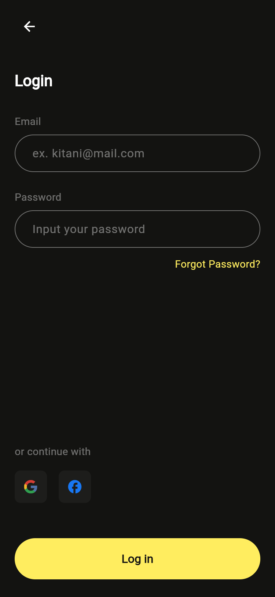](docs/screenshots/02_login.png) |
| 03 | Sign up | [signup_page.dart](lib/features/auth/signup_page.dart) | [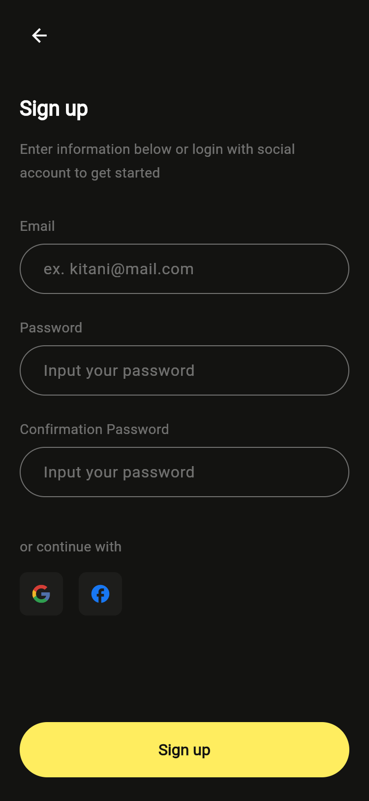](docs/screenshots/03_signup.png) |
| 04 / 05 | Home（顶部 / 滚动后） | [home_page.dart](lib/features/home/home_page.dart) | [](docs/screenshots/04_home.png) |
| 06 | Artist Playlist | [show_page.dart](lib/features/show/show_page.dart) | [](docs/screenshots/06_artist_playlist.png) |
| 07 | Player | [player_page.dart](lib/features/player/player_page.dart) | [](docs/screenshots/07_player.png) |
| 08 | Player Minimize | [kt_shell.dart](lib/shell/kt_shell.dart)（`KtMiniPlayer`） | [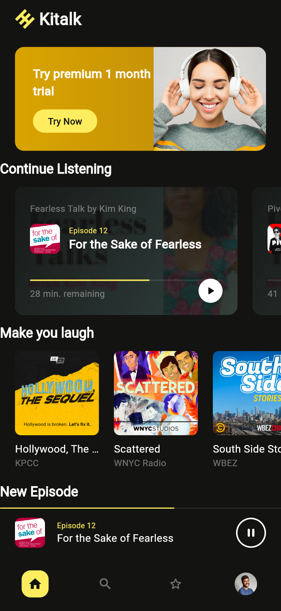](docs/screenshots/08_player_minimize.png) |
| 09 | Search | [search_page.dart](lib/features/search/search_page.dart) | [](docs/screenshots/09_search.png) |
| 10 | Search Result | [search_result_page.dart](lib/features/search/search_result_page.dart) | [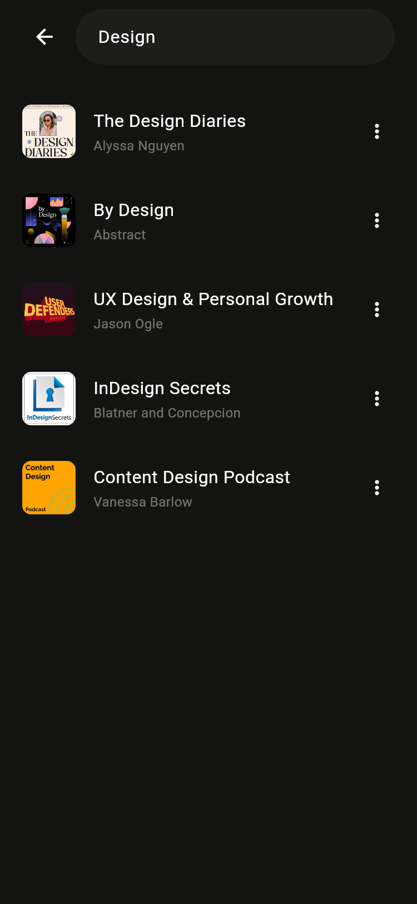](docs/screenshots/10_search_result.png) |
| 11 | Categories | [category_page.dart](lib/features/category/category_page.dart) | [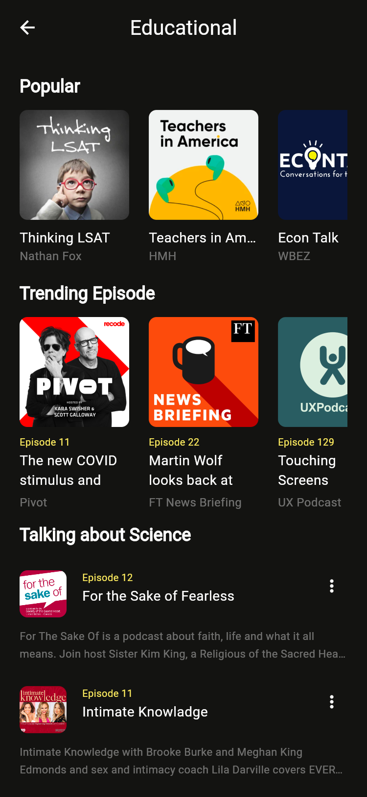](docs/screenshots/11_categories.png) |
| 12 | Favourite Episodes | [favourites_page.dart](lib/features/favourites/favourites_page.dart) | [](docs/screenshots/12_favourite_episodes.png) |
| 13 | Favourite Shows | [favourites_page.dart](lib/features/favourites/favourites_page.dart) | [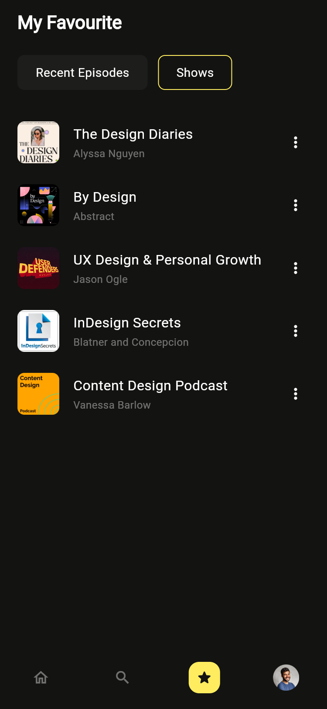](docs/screenshots/13_favourite_shows.png) |
| 14 | Profile | [profile_page.dart](lib/features/profile/profile_page.dart) | [](docs/screenshots/14_profile.png) |
| 15 | Edit Profile | [edit_profile_page.dart](lib/features/profile/edit_profile_page.dart) | [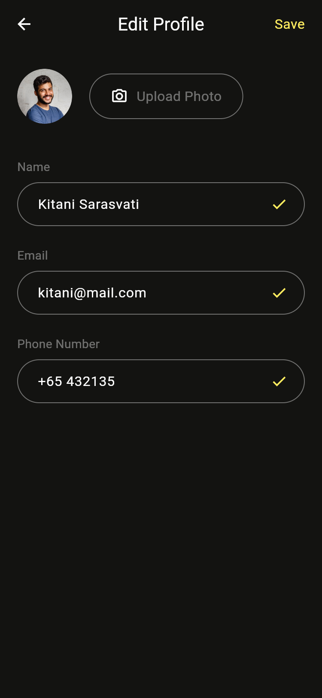](docs/screenshots/15_edit_profile.png) |
| 16 | Subscription | [subscription_page.dart](lib/features/subscription/subscription_page.dart) | [](docs/screenshots/16_subscription.png) |
| 17 | Modal Dialogue | [sheets.dart](lib/core/sheets.dart)（`showQualitySheet`） | [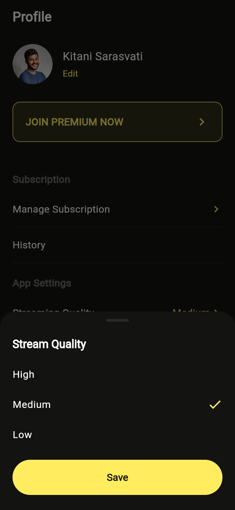](docs/screenshots/17_modal_dialogue.png) |
| — | Light Home / Player | 同一批界面 + `KtPalette.light` | [](docs/screenshots/20_home_light.png) |

## 关键界面

### Artist Playlist → Player
节目页用模糊封面铺头，单集行复用 `KtEpisodeTile`；播放页整屏铺封面 + 渐变，拖动条与传输控件走 `KtStore`。

 

### 搜索与分类
搜索页是双列瀑布分类（`BrowseCategory.column` + `tall` 标记还原 Top 10 大卡），点击进入分类页。

 

### 收藏与资料
Favourites 两个 Tab 复用同一份 `KtStore` 收藏集合；Profile 承载主题开关、音质弹窗、Premium 状态，订阅页月/年套餐卡确认后写回 `store.premium`。

  

## 运行与验证

Android release 包已在模拟器（375×812 dp @2x，与设计稿同尺寸）安装并跑通完整链路：
Onboarding → Log in → Home → 点击 Premium 横幅 → Subscription。下图为实机 Home 截图。

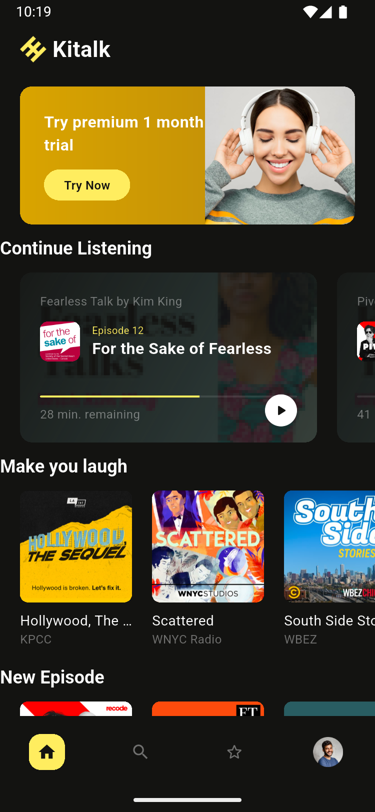

`docs/screenshots/` 下的截图统一在 375×812 dp、2x 设备像素比下渲染，尺寸与 Pixso 画板（750×1624）完全一致，可直接叠图比对。

## 精简记录

开发过程中移除的临时产物，避免留在交付代码里：

- 截图用的 `lib/tools/capture_app.dart` 与 `web/` 平台目录（截图完成后删除）
- `KtPalette` 初版用 `ThemeData(extension:)` 的错误写法，改为标准 `ThemeExtension` + `extensions: []`
- 底部导航曾为第 4 个槽位写的 `.let()` 扩展、`KtStore` 里恒真的 `showMiniPlayer` 判断、Home 中未被引用的成员
- `BrowseCategory` 最初只有 `wide` 布尔，无法表达双列错落，换成 `column` + `tall`
- 未使用的 `Episode.isStarted` getter、`filterQuality` 默认值参数、只包一个子控件的 `Row + Spacer`
- 嵌套的 `kitalk/` 工程目录（已上提到仓库根，方便直接 clone 运行）

当前 `lib/` 21 个文件、3103 行，无 dead code、无 TODO、`flutter analyze` 干净。
